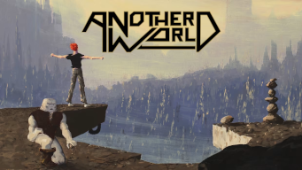

# AnotherWorld-DS 

AnotherWorld-DS is based on newraw engine (http://sourceforge.net/projects/newraw/)
newraw is a re-implementation of the engine used in the game Another World. This 
game, released under the name Out Of This World in non-European countries, was 
written by Eric Chahi at the beginning of the '90s. More information can be found online.

Features :
-----------------------
It's fairly complete... save and restore of states, full sound, no slowdown even on older hardware...

Copyright :
-----------------------
AnotherWorld-DS is Copyright (c) 2026 Dave Bernazzani (wavemotion-dave) and (c) 2011 by Alekmaul

The original RAW engine was released as GPL Version 2 - as such, this program follows suit. See copying.txt for details.

As long as there is no commercial use (i.e. no profit is made),
copying and distribution of this emulator, it's source code
and associated readme files, with or without modification, 
are permitted in any medium without royalty provided this 
copyright notice and the GPL V2 notice is used and 
wavemotion-dave (Pheonix Edition), Alekmaul (original port) and 
Gregory Montoir (original RAW engine) are thanked profusely.

The AnotherWorld-DS emulator is offered as-is, without any warranty.

Instructions :
-----------------------

You will need to supply the original files from English version of Out Of this 
World from the DOS version of the game. No other versions will work here. 
You need the following data files:

 * MEMLIST.BIN    
 * BANK01    
 * BANK02    
 * etc...
 * BANK0D
	
You can find these files if you have the Another World disk image (Disk1.img) - you 
need to simply extract the AWORLD.EXE file and then open that with some archive 
manager that will handle LHA compression - the files will be easily seen. If you have
installed a playable version of the game, you can find these files in the C:\ANOTHER directory.

To start the game, you must :
- create a directory at the root of your SD card named RAW
- put all the game's datafiles in the directory named RAW 
- run AnotherWorld-DS.nds

That's all, AnotherWorldDS can be run.

Controls :
 * Direction pad : the joystick ... (up used to to jump & swim)
 * A           : allow you run/shoot with your gun
 * B           : used to to jump & swim (easier than UP)
 * SELECT      : allow to enter a code to jump at a specific level
 * START       : pause the game
 * Touchscreen : exit the game back to the main menu
 * R           : Save game state (use L to load or select 'Last Game' on the main menu)
 * L           : Load game state
 
Credits:
-----------------------

Thanks Wintermute for devkitpro and libnds (http://www.devkitpro.org).
  Eric Chahi, Delphine Software, obviously, for making this great game.
  Gregory Montoir, cyx@users.sourceforge.net (original RAW engine for PC)
  
Massive thanks to Alekmaul for the original 1.0 port.

History :
-----------------------
V1.1 : by wavemotion-dave on 23-Nov-2026
  * Resurrected from the ashes.
  * Major sound rework and improvements.
  * Fixes for running on DSi/XL/LL and via Twilight Menu++ or Unlaunch.
  * ITCM and DTCM use for improved rendering speed.
  * Cleanup of Video mode handling.
  * Fix for 'Last Game' to actually load the last saved game played.
  * Added 'SAVED' icon when saving game.
  * START key now properly pauses the game.
  * Other minor fixes and improvements as time permitted.

V1.0 : by Alekmaul on 16/07/2011
  * Initial release based on newraw engine
